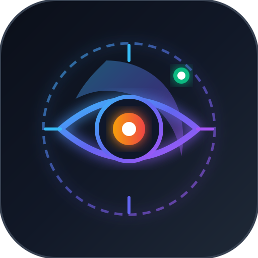

<!-- Created by 11Hopem -->
# mac-anti-sleep (ai-sleep-guard)

<p align="center">
  
</p>

<p align="center">
  <b>Autonomous macOS Display & System Sleep Guard for Antigravity, Claude Code, and OpenAI Codex</b>
</p>

<p align="center">
  
  
  
  
  
</p>

---

## 1. Project Title, Badges & Vision
`mac-anti-sleep` (`ai-sleep-guard`) is a specialized macOS system daemon that guarantees your Mac display will **never sleep or turn black while AI agent prompts are running**. It natively monitors:
1. **Google Antigravity (Burda):** Active conversation turns, tool calls, and streaming responses in Antigravity IDE.
2. **Claude Code:** Prompts, shell commands, and subagent runs via native lifecycle hooks and process inspection.
3. **OpenAI Codex:** Active code generation, tool calls, and turns via SQLite WAL updates and notify wrappers.

When an AI prompt begins, the daemon immediately creates an active display assertion (`caffeinate -d -i`). Once all prompts conclude, it enforces a gentle **45-second cooldown buffer** before restoring macOS's default power-saving sleep timer.

---

## 2. Live Links & Project Registry
- **Private GitHub Repository:** [https://github.com/umutocguder/mac-anti-sleep](https://github.com/umutocguder/mac-anti-sleep)
- **Firebase Project ID:** `hopem-software-cloud`
- **Firestore Telemetry Collection:** `telemetry_logs`
- **Service Identifier:** `com.11hopem.ai-sleep-guard`
- **Official Brand Domain:** [https://11hopem.com](https://11hopem.com)

---

## 3. Real-World Operational Context
- **Target Workstation:** macOS Developer Environment running Antigravity IDE, Claude Code CLI, and Codex CLI.
- **Problem Solved:** When AI models execute long-running prompts, deep reasoning chains, or extensive multi-file tool invocations, the developer often steps away from the keyboard. macOS display sleep timeouts (5–30 minutes) dim the screen, trigger screensavers, or lock the workstation, interrupting observation and workflow continuity.
- **Solution:** A zero-configuration, zero-dependency background LaunchAgent that detects prompt states across all 3 AI environments and maintains uninterrupted screen visibility.

---

## 4. Key Features & Interactive Capabilities
- **Multi-Agent Active Prompt Tracking:**
  - **Antigravity:** Real-time read-only inspection of `~/.gemini/antigravity/conversation_summaries.db` for `CASCADE_RUN_STATUS_RUNNING` and `not_fully_idle = 1`, plus recent brain transcript updates.
  - **Claude Code:** Hooked into `UserPromptSubmit`, `PreToolUse`, `SubagentStart`, `Stop`, and `SessionEnd` in `~/.claude/settings.json`.
  - **OpenAI Codex:** Hooked into `notify` in `~/.codex/config.toml` alongside active SQLite WAL monitoring.
- **Zero-Dependency Core:** Built 100% on Python 3 standard library (`sqlite3`, `subprocess`, `os`, `signal`, `urllib`).
- **macOS Native Caffeinate Integration:** Calls `/usr/bin/caffeinate -d -i` to create legitimate system assertions (`PreventUserIdleDisplaySleep` and `PreventUserIdleSystemSleep`).
- **Intelligent 45s Cooldown Buffer:** Prevents flickering display power cycles between consecutive agent turns.
- **Rich Status CLI:** Terminal dashboard with ANSI color badges displaying live detector statuses and active PIDs.
- **Manual Overrides:** Quick `ai-sleep-guard on` and `ai-sleep-guard off` commands for ad-hoc presentations or downloads.

---

## 5. Architecture, Tech Stack & Directory Tree
```
mac-anti-sleep/
├── AGENTS.md                          # Engineering blueprint and standards
├── CLAUDE.md                          # Claude Code unified rule link
├── WORKLOG.md                         # Detailed AI Handoff changelog
├── README.md                          # Rich 10-section documentation
├── .gitignore                         # Strict exclusion rules
├── com.11hopem.ai-sleep-guard.plist    # macOS LaunchAgent definition
├── assets/
│   └── images/logo.svg                # 1:1 Vector brand mark
├── scripts/
│   ├── ai-sleep-guard                 # Main CLI launcher
│   ├── codex_notify.sh                # Codex notification bridge
│   ├── install.sh                     # Automated installer
│   └── uninstall.sh                   # Clean uninstaller
├── src/
│   ├── __init__.py
│   ├── cli.py                         # CLI argument dispatcher
│   ├── daemon.py                      # Continuous monitoring engine
│   ├── caffeinate_manager.py          # Process & assertion lifecycle
│   ├── telemetry.py                   # Firestore & local audit logger
│   └── detectors/
│       ├── __init__.py
│       ├── base.py                    # Base utilities
│       ├── antigravity.py             # Antigravity SQLite detector
│       ├── claude.py                  # Claude Code hook & process detector
│       └── codex.py                   # Codex WAL & notify detector
├── tests/
│   ├── test_detectors.py              # Detector unit test suite
│   ├── test_caffeinate_manager.py     # Caffeinate manager test suite
│   ├── test_telemetry.py              # Telemetry test suite
│   └── test_cli.py                    # CLI command test suite
└── data/
    └── telemetry_logs.jsonl           # Local audit event log
```

---

## 6. Security, Anti-Bot & Isolation Shield
- **100% Read-Only Database Queries:** Antigravity and Codex databases are queried using SQLite URI read-only immutable mode (`file:...db?mode=ro`) with 1.0-second timeouts, guaranteeing zero database locks or write conflicts.
- **Local Data Custody:** Telemetry is written to local JSON Lines first before any network transmission.
- **Clean Signal Isolation:** Inter-process signals use secure, isolated temporary files in `/tmp/ai_sleep_guard/`.
- **Zero Credentials in Repository:** No API keys or tokens are stored in the codebase; all communications use public endpoints or local CLI tooling.

---

## 7. Firebase Telemetry & Live Metrics
Every state change is captured locally in `data/telemetry_logs.jsonl` and mirrored to Cloud Firestore REST (`hopem-software-cloud`):
- `DAEMON_START`: Daemon initialization parameters.
- `CAFFEINATE_START`: Triggered when an AI prompt starts; records PID, flags, and activating agent.
- `CAFFEINATE_STOP`: Triggered when prompts conclude and cooldown expires; records total duration.
- `PROMPT_ACTIVE`: Agent prompt detection events.

---

## 8. Autonomous Data Backup
- Local audit logs are preserved in `data/telemetry_logs.jsonl`.
- LaunchAgent stdout and stderr logs are recorded in `/Users/umut/Library/Logs/mac-anti-sleep/`.

---

## 9. Installation, Testing & Quality Assurance
### Quick Installation
```bash
cd /Users/umut/mycodespaces/mac-anti-sleep
bash scripts/install.sh
```

### Checking Live Status
```bash
ai-sleep-guard status
```

### Running Automated Tests
```bash
python3 -m unittest discover -s tests -v
```

### Manual Overrides
```bash
ai-sleep-guard on       # Force display awake
ai-sleep-guard off      # Restore normal sleep
ai-sleep-guard wrap npm run build   # Keep display awake while command runs
```

---

## 10. 11Hopem Attribution & Legal
Created by [11Hopem](https://11hopem.com).
Copyright (c) 2026 11Hopem. All rights reserved.
Licensed under 11Hopem Proprietary License.
